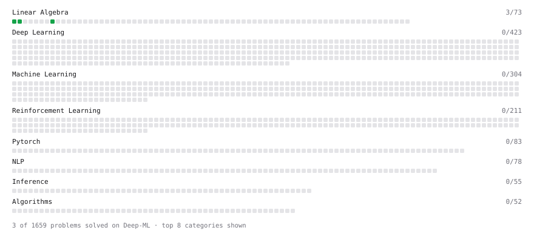

# Deep-ML

My machine learning practice from [Deep-ML](https://www.deep-ml.com). Every solution here was written by hand.

**5** solved · 3 problems · 0 labs · 2 math

[**Browse the interactive portfolio**](https://r9-pena.github.io/deep-ml/) to replay this filling in over time.

## Problems

| | Difficulty | Solved | |
| --- | --- | --- | --- |
| [Calculate 2x2 Matrix Inverse](https://www.deep-ml.com/problems/8) | easy | 2026-10-26 | [solution](problems/0008-calculate-2x2-matrix-inverse) |
| [Matrix-Vector Dot Product](https://www.deep-ml.com/problems/1) | easy | 2026-10-20 | [solution](problems/0001-matrix-vector-dot-product) |
| [Transpose of a Matrix](https://www.deep-ml.com/problems/2) | easy | 2026-10-20 | [solution](problems/0002-transpose-of-a-matrix) |

## Math

| | Difficulty | Solved | |
| --- | --- | --- | --- |
| [Inverse and Rank](https://www.deep-ml.com/math-problems/12) | medium | 2026-10-26 | [solution](math/0012-inverse-and-rank) |
| [Solving Linear Systems](https://www.deep-ml.com/math-problems/13) | medium | 2026-10-26 | [solution](math/0013-solving-linear-systems) |

---

_This file is regenerated by Deep-ML on every push._
